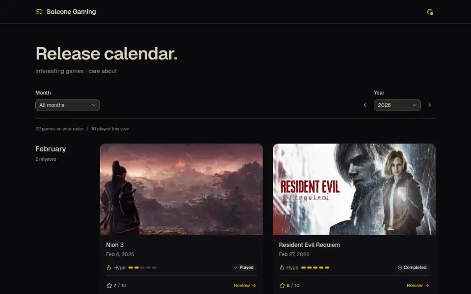

# Soleone Gaming

A personal release calendar for the games I'm watching: how hyped I am before launch, and a short scored review once I've played them.

**[Open the calendar](https://gaming.soleone.xyz)**, no install or account.



## What's in it

- **Cover-led cards grouped by month.** Browse one year at a time, or narrow it to a month. Uncertain dates stay honest: a game slated for "Q2 2027" or just "2027" gets its own section instead of a made-up day.
- **Hype before, verdict after.** Each game has a 1 to 5 hype rating and a play status. Once started, it can carry a review with a 1 to 10 score, a short write-up and Amazing, Nice, Questionable and Terrible lists. Spoilers hide behind `||double bars||`, and every review has its own URL.
- **Themes.** Gilt by default, plus the rest of the @soleone theme picker.

The hosted site is read-only. The collection is one JSON file, `src/data/games.json`, embedded at build time.

## Run it locally

Needs Node 24 and [Vite+](https://viteplus.dev) (`vp`).

```sh
vp install
vp run dev
```

On the local dev server, **Add a game** and each card's pencil button open an editor that writes straight to `src/data/games.json`. An optional research agent, powered by your own Pi login, finds release dates and cover art from official pages and proposes them for you to accept. Neither exists in the production build.

Editing, the agent, the date model and the security boundary are covered in [docs/maintenance.md](docs/maintenance.md). Behavior rules live in [spec/](spec/README.md).

## Media

`vp run media:capture` re-records `docs/media/hero.png` and `docs/media/demo.webp` from the live site (pass `-- --url http://localhost:4173` to record `vp run preview` instead). It needs agent-browser and FFmpeg on the PATH.

Cover art belongs to its publishers and is used here as editorial reference; sources are listed in [docs/assets.md](docs/assets.md).
